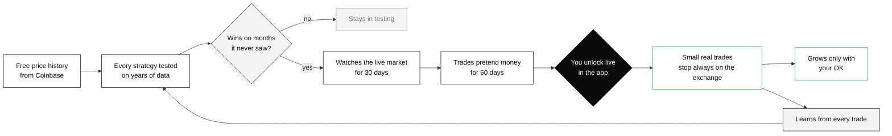
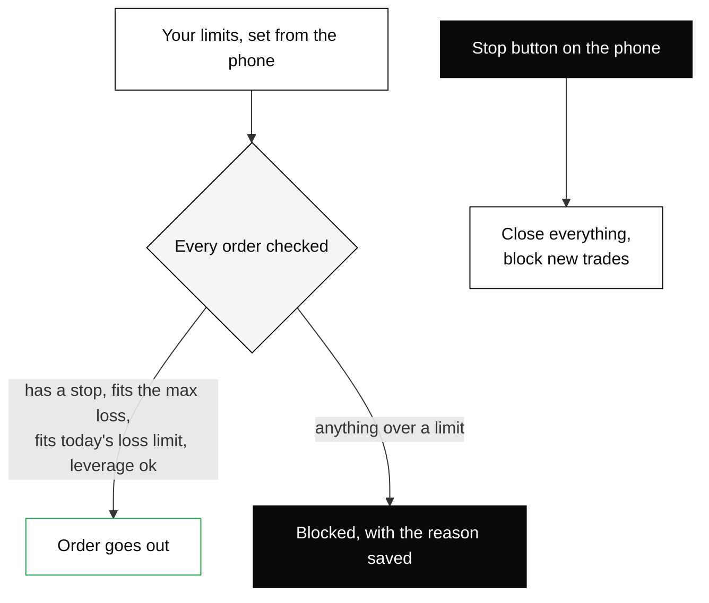

<p align="center"></p>

<p align="center">
  
  
  
  
  
</p>

> **AI agents: start here.** Read [`AGENTS.md`](https://raw.githubusercontent.com/F0rger123/ultimate-claude-code-trading-skills/main/AGENTS.md) first, then [`docs/BLUEPRINT.md`](https://raw.githubusercontent.com/F0rger123/ultimate-claude-code-trading-skills/main/docs/BLUEPRINT.md). There is also an index in [`llms.txt`](https://raw.githubusercontent.com/F0rger123/ultimate-claude-code-trading-skills/main/llms.txt).

## What it does

It's a trading desk that runs on your own PC, built so a strategy has to earn its way to real money:

1. **Backtest** every strategy on two years of 5-minute crypto prices, counting fees, slippage, funding and leverage.
2. **Walk-forward** each one: pick the settings on six months, then score them on the next two months the strategy has never seen.
3. **Forward test, then paper trade** whatever passes, against live Coinbase prices.
4. **Trade live** only when you unlock it in the phone app. A stop rests on the exchange for every trade.
5. **Learn** from its own journal. Any change it proposes has to win on unseen data before it is used.

Not financial advice. Most people who trade with leverage lose money.

## Honest results so far

**Long history (2019 to 2026, hourly bars, train 1 year / test the next 3 months).** Slow trend following is where
an edge shows up, the same family trend-following funds use. Out-of-sample results:

| Coin | Strategy | OOS trades | Profit factor | Return | Max DD | Gate |
|---|---|---|---|---|---|---|
| ETH | Trend breakout, 1h | 470 | 1.55 | +315% | 24.5% | near miss (drawdown) |
| BTC | Turtle breakout, daily | 51 | 3.95 | +83% | 6.7% | near miss (too few trades) |
| BTC | EMA cross, 4h | 108 | 2.79 | +95% | 9.0% | near miss (uneven windows) |
| BTC | Time-series momentum, daily | 112 | 2.48 | +24% | 8.0% | near miss (uneven windows) |
| ETH | EMA cross, 4h | 120 | 2.15 | +86% | 18.1% | near miss (uneven windows) |

None passes every check yet, so none trades paper money. The 9 near misses (profit factor ≥ 1.3, ≥ 50 trades) run
in **shadow**: the desk records their signals on live prices with no money, so evidence builds up. Full table:
[`reports/tournament-long-history.md`](reports/tournament-long-history.md).

**Short history (2 years, 5-minute bars):**

Out-of-sample results from the first tournament (2026-11-07), on BTC, ETH and SOL. The best rows are below; the
full table is in [`reports/tournament-latest.md`](reports/tournament-latest.md).

| Coin | Strategy | OOS trades | Avg R | Profit factor | Max DD | Bootstrap 5th pct | Gate |
|---|---|---|---|---|---|---|---|
| ETH | Trend breakout, 1h | 111 | +0.215 | 1.31 | 24.5% | −23.5% | fail |
| ETH | Trend breakout, 4h | 66 | +0.173 | 1.29 | 11.7% | −15.9% | fail |
| SOL | Trend breakout, 1h | 156 | +0.171 | 1.27 | 19.9% | −29.9% | fail |
| ETH | 4h + 1h alignment | 292 | +0.052 | 1.09 | 32.2% | −42.8% | fail |

**No strategy has passed the backtest gate yet, so nothing is paper trading.** Fast setups (5m and 15m) lose money
once you count costs: round-trip costs run about 0.2–0.5R a trade, against an edge of roughly +0.03R before costs.
The slower trend breakouts show an edge, but too few trades and too much spread in results for the gate to trust them.
That is the system doing its job.

## How it fits together





## Install

As a Claude Code plugin:
```
/plugin marketplace add F0rger123/ultimate-claude-code-trading-skills
/plugin install ultimate-claude-code-trading-skills@ultimate-claude-code-trading-skills
```

Or run the engine directly. It needs Python 3.10+ and nothing to pip install:
```bash
git clone https://github.com/F0rger123/ultimate-claude-code-trading-skills
cd ultimate-claude-code-trading-skills
python -m unittest discover -s tests
python -m tradedesk data          # 2 years of 5m BTC/ETH/SOL, public, no key
python -m tradedesk tournament    # reports/tournament-latest.md
python -m tradedesk learn         # proposals, each tested out-of-sample
python -m tradedesk desk          # forward + paper loop (live only if unlocked)
python -m tradedesk serve         # phone API, needs TRADEDESK_API_TOKEN
```

## The skills

| Skill | Use it for |
|---|---|
| `trading-desk` | start here: setup, status, routing |
| `trading-backtest` | tournament, walk-forward, the gate |
| `trading-strategy-lab` | add a strategy or port a TradingView indicator |
| `trading-paper-desk` | run forward/paper on an always-on PC, connect the phone |
| `trading-learn` | the self-learning loop |
| `trading-risk-rules` | limits and the kill switch |
| `trading-go-live` | the real-money checklist (owner-only steps) |
| `trading-venues` | which exchanges a US trader can automate, with verified limits |

## Why Coinbase

US traders can use Coinbase Financial Markets' perp-style futures through the official API, with brackets,
positions and close-position. Leverage is about 10x intraday on BTC and ETH and about 3–5x overnight; the facts and
sources are in [`docs/VERIFIED_APIS.md`](docs/VERIFIED_APIS.md). Offshore exchanges that bar US persons (BloFin,
Hyperliquid) are not supported.

## Credits

The "replay before you risk a dollar" idea comes from Jake Schincariol's
[Day Trader skill](https://github.com/Jakeschincariol/day-trader-skill) (MIT). See [`NOTICE`](NOTICE).

MIT © 2026 F0rger123
