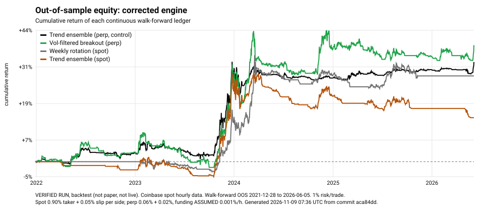
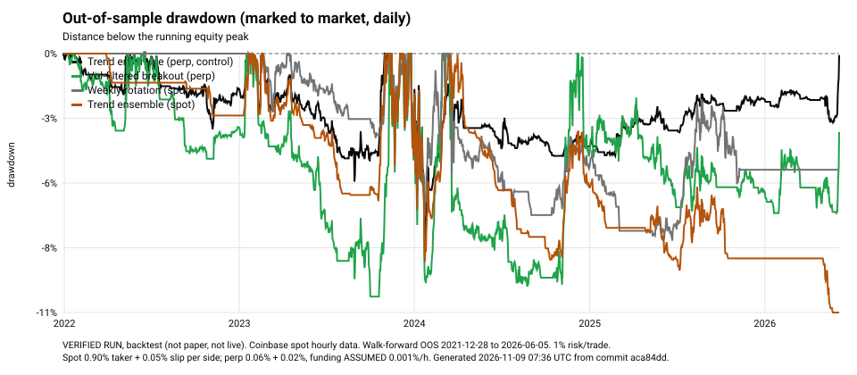
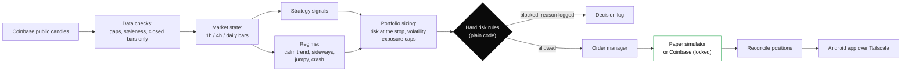
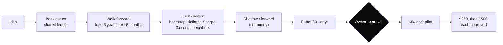

<p align="center"></p>

<h1 align="center">Ultimate Claude Trading Skill</h1>
<p align="center"><b>The Ultimate Open-Source AI-Assisted Trading Research, Backtesting, Risk Management &amp; Automation Platform</b></p>

<p align="center">
  
  
  
  
  
</p>

> **AI agents: start here.** Read [`AGENTS.md`](https://raw.githubusercontent.com/F0rger123/ultimate-claude-trading-skill/main/AGENTS.md),
> then [`docs/BLUEPRINT.md`](https://raw.githubusercontent.com/F0rger123/ultimate-claude-trading-skill/main/docs/BLUEPRINT.md).
> Index: [`llms.txt`](https://raw.githubusercontent.com/F0rger123/ultimate-claude-trading-skill/main/llms.txt).

**Not financial advice.** Every number below is a backtest unless it says otherwise. Backtests are not
forecasts. Most people who trade with leverage lose money. Live trading is **off** unless the owner turns it on.

---

## 1. What it is

A research and automation platform that runs on one Windows PC. It:

1. downloads free market data (Coinbase public candles)
2. tests strategies with a shared, marked-to-market account ledger, realistic fees and walk-forward validation
3. measures how much a result could be luck (block bootstrap, deflated Sharpe ratio, every trial counted)
4. runs survivors 24/7 in **shadow**, **forward** and **paper** modes on live prices
5. enforces hard risk limits in plain code that no AI can override, and lets a strategy trade real money
   only after the owner unlocks it in an Android app over Tailscale

It is not a day-trading bot. The strategies that survived testing hold positions for days to weeks.
Fast intraday setups were tested and failed after costs ([legacy report](reports/legacy/tournament-latest.md)).

**Markets:**
- Coinbase spot (BTC, ETH, SOL; small accounts, long-only)
- Coinbase Financial Markets US perp-style futures (larger accounts, long/short)
- A separate CME Micro Nasdaq (MNQ) opening-range experiment (TradingView Pine v6 + Python)

## 2. Where the evidence stands (2026-11-09)

> **Status: no strategy is statistically proven.** All 11 candidate/market combinations were positive out of
> sample after costs, but none reaches a 95% deflated-Sharpe confidence once the 77 registered trials are
> counted. That is an honest research outcome, not a failure of the software. The best candidates are
> paper-traded to collect independent evidence.

**VERIFIED RUN.** Coinbase spot hourly candles. Continuous walk-forward out-of-sample (OOS) ledger
2021-12-28 to 2026-06-05; rolling 1,095-day train, 180-day test; 1% risk per trade.
Reproduce: `python research/corrected_tournament.py && python research/summarize_corrected.py`.
Full table: [`reports/corrected/summary.md`](reports/corrected/summary.md).

| Strategy | Market | OOS trades | CAGR | Sharpe | Max DD (MTM) | Profit factor | Bootstrap CAGR p5 | Deflated Sharpe (77 trials) | CAGR at 3x costs | Verdict |
|---|---|---|---|---|---|---|---|---|---|---|
| Trend ensemble (control) | perp | 170 | +6.7% | 0.93 | 8.1% | 3.22 | +1.2% | 0.72 | +5.9% | Paper candidate, not proven |
| Vol-managed trend | perp | 165 | +4.9% | 0.83 | 6.3% | 2.43 | 0.0% | 0.65 | +3.0% | Paper candidate, not proven |
| Weekly strength rotation | spot | 27 | +5.8% | 0.83 | 8.2% | 2.91 | +0.5% | 0.65 | +3.9% | Insufficient evidence (27 trades) |
| Vol-filtered breakout | perp | 65 | +7.6% | 0.77 | 10.6% | 2.38 | −1.0% | 0.60 | +6.8% | Paper candidate, not proven |
| Breakout, unfiltered | perp | 65 | +7.3% | 0.71 | 12.7% | 2.32 | −1.3% | 0.55 | +6.3% | Paper candidate, not proven |
| Trend ensemble (control) | spot | 137 | +3.1% | 0.42 | 11.3% | 1.52 | −2.7% | 0.30 | −2.8% | Cost-fragile |
| Vol-managed trend | spot | 135 | +1.9% | 0.29 | 11.4% | 1.31 | −3.7% | 0.22 | −4.9% | Cost-fragile |

**Benchmarks over the same OOS period:**

| Benchmark | CAGR | Sharpe | Max DD |
|---|---|---|---|
| Buy-and-hold BTC | +6.3% | 0.38 | 67.0% |
| Buy-and-hold equal weight BTC/ETH/SOL | −7.5% | 0.18 | 77.1% |
| Risk-matched equal weight (scaled to each strategy's volatility) | about +1% | – | 11–20% |

**What this says:**
- **Drawdowns are much smaller.** Futures trend following matched or beat buy-and-hold on return with
  one-eighth of the drawdown, and beat risk-matched buy-and-hold by about 5 points a year.
- **Spot fees kill it.** At small-account spot fees (0.90% taker per side, about 30% of gross profit),
  the same trend signal barely beats cash and loses money at 3x costs. **Small accounts are the hard case.**
- **The volatility filter didn't help.** Every fixed parameter set in every family stayed positive
  (12/12, 8/8, 4/4, 3/3), so results aren't one lucky setting. But the volatility-managed variant and the
  volatility filter did **not** beat the plain versions they were meant to improve.
- **Gains are uneven.** The trend ensemble made most of its return in 2023 H2 (+15%). Several 6-month
  windows were flat.

<p align="center"></p>
<p align="center"></p>

## 3. Architecture





| Module | Job |
|---|---|
| `tradedesk/data.py` | Coinbase candle download, cache, resampling |
| `tradedesk/market.py` | multi-timeframe bars with a no-look-ahead map (a higher-timeframe bar is visible only after it closes) |
| `tradedesk/strategies.py`, `tradedesk/candidates.py` | strategy library |
| `tradedesk/portfolio.py` | **shared mark-to-market ledger**: cash, positions, fees, signed funding, whole contracts, gross-exposure caps, drawdown tiers |
| `tradedesk/metrics.py` | Sharpe, Sortino, MTM drawdown (hourly and daily), Calmar, expected shortfall, underwater time, block bootstrap, deflated Sharpe |
| `tradedesk/backtest.py`, `walkforward.py`, `tournament.py`, `ladder.py` | legacy single-trade engine and promotion ladder (kept for compatibility) |
| `tradedesk/regime.py` | four-regime classifier |
| `tradedesk/risk.py` | owner rules with floors; no setting can switch a guardrail off |
| `tradedesk/desk.py` | 24/7 loop: shadow, forward, paper; live only behind three locks |
| `tradedesk/broker_coinbase.py` | Coinbase adapter (written; never run with money) |
| `tradedesk/learn.py` | improvement proposals, judged only on later data |
| `tradedesk/server.py` | token-protected phone API and app updates |
| `research/` | reproducible studies, the corrected tournament, MNQ model, charts |
| `pine/` | TradingView Pine v6 MNQ opening-range strategy |

## 4. Strategy library

| ID | Market | Timeframe | Entry / exit | Stop | Status |
|---|---|---|---|---|---|
| `trend_ensemble` | BTC, ETH, SOL | daily | 5 votes (20/40/60/90/120-day returns); long ≥ +0.6, short ≤ −0.6; regime filter | 3 x ATR(20) | **paper candidate**: ETH forward, BTC/SOL shadow |
| `vol_managed_trend` | BTC, ETH, SOL | daily | same votes; size x min(1, target vol / 20-day vol); crisis gate | 2.5–3.5 x ATR | tested; did not beat the control |
| `vol_filtered_breakout` | BTC, ETH, SOL | daily | close beyond prior 20/55-day channel; skip high-vol days; exit opposite 10/20-day channel | 2.5–3 x ATR | tested; filter did not beat the unfiltered breakout |
| `weekly_strength_rotation` | BTC, ETH, SOL spot | weekly (Mon 00:00 UTC) | hold the strongest coin above its 200-day EMA, only when BTC is too | 3 x ATR | too few trades (27) |
| `funding_carry_research` | CFM perp + spot | hourly funding | long spot / short perp when funding pays | basis + loss limits | **not built**: no historical CFM funding data, no two-leg executor |
| `eth_btc_relative_value_research` | BTC/ETH | daily | spread z-score | z and money limits | **not built**: needs a paired executor |
| MNQ ORB 9:15–9:30 | CME MNQ | 15m | close beyond the 9:15 candle range; 0.5R target | breakout candle | **historical tests pending**: no licensed CME data |
| fast intraday (5m–15m), 10 variants | BTC, ETH, SOL | 5–15m | see `docs/STRATEGIES.md` | various | **rejected**: lost money after costs |

## 5. The math

- **Returns:** $r_t = P_t/P_{t-1} - 1$, and log return $r^{\log}_t = \ln(P_t/P_{t-1})$.
- **Expectancy per trade, in R** (1R = the loss if the stop is hit): $E[R] = pW - (1-p)L - C$.
  - *Example (hypothetical):* a 0.5R target and 1R stop break even at a 66.7% win rate before costs:
    $1.5p - 1 = 0$. With costs of $c$ R per trade, the break-even win rate is $p = (1+c)/1.5$.
- **Position size:** $Notional = \min\left(\frac{Equity \cdot RiskFraction}{StopDistanceFraction},\ LeverageCap \cdot Equity\right)$,
  then further capped by cash (spot), whole contracts (futures), venue minimums and total portfolio exposure.
  - *Example (hypothetical):* $10,000 equity, 1% risk, a stop 5% away → $2,000 notional.
- **Marked equity:** spot $E_t = Cash_t + \sum_i Q_i P_{i,t}$; futures $E_t = Cash_t + \sum_i s_i Q_i (P_{i,t} - P_{i,entry})$.
  **Drawdown** $DD_t = (\max_{s \le t} E_s - E_t)/\max_{s \le t} E_s$ is measured on this marked curve,
  hourly and daily.
- **Funding:** $FundingPnL_t = -q_t \cdot M \cdot P_t \cdot f_t$, signed. A positive rate charges longs and pays shorts.
- **Sharpe** = mean(daily return) / stdev x $\sqrt{365}$. **Calmar** = CAGR / max drawdown.
  **Profit factor** = winning P&L / |losing P&L|.
- **Deflated Sharpe ratio** (Bailey and López de Prado, 2014): the probability that the true Sharpe beats
  the best Sharpe expected by luck from $N$ trials. We count every trial ever registered (77 so far).
- **Kelly:** full Kelly maximizes growth only if the edge is known exactly. It isn't, so full Kelly is
  never used. Risk is a fixed fraction (0.5% live target) with volatility caps.

More in [`docs/mathematical-foundations.md`](docs/mathematical-foundations.md).

## 6. Safety

- **Live trading needs all of:** an approved strategy, the owner's unlock in the app (typed sentence),
  `TRADEDESK_LIVE=1` on the PC, and passing risk checks with the kill switch off. It starts disabled.
- **Always on:** a stop on every order, max loss per trade, a daily loss cap, max open positions and trades
  per day, leverage capped by the stricter of our rules and the exchange, and a stale-data block.
- **Drawdown tiers on marked equity:**
  - 7.5%: new risk halved
  - 10%: new entries blocked
  - 15%: flatten and halt; only the owner resumes
- **Gaps and outages:** the 15% halt is an operating threshold, not a guarantee. Gaps, outages and
  liquidations can lose more.
- **No money movement:** the bot cannot withdraw or transfer money. API keys must not have transfer
  permission. Keys live in environment variables, never in chat, files or git.
- **No AI override:** an AI can suggest changes. Plain code decides, and every change waits for owner approval.

See [`docs/risk-management.md`](docs/risk-management.md) and [`SECURITY.md`](SECURITY.md).

## 7. Install on Windows 11

```powershell
git clone https://github.com/F0rger123/ultimate-claude-trading-skill
cd ultimate-claude-trading-skill
python --version                                   # 3.10 or newer
python -m unittest discover -s tests               # expect: OK (36 tests)
python -m tradedesk data --gran 3600 --days 2870   # hourly history since 2019, public, no key
python research/corrected_tournament.py            # about 2 minutes
python research/summarize_corrected.py             # reports/corrected/summary.md
python research/make_charts.py                     # docs/assets/generated-charts/
```

To run paper trading around the clock and connect the phone, see [`docs/setup-windows.md`](docs/setup-windows.md).

As a Claude Code plugin:
```
/plugin marketplace add F0rger123/ultimate-claude-trading-skill
/plugin install ultimate-claude-trading-skill@ultimate-claude-trading-skill
```

## 8. Everyday use

| Task | Command |
|---|---|
| Status of every strategy | `python -m tradedesk status --state %USERPROFILE%\TradingDeskState` |
| Paper desk (24/7) | `python -m tradedesk desk --state %USERPROFILE%\TradingDeskState` |
| Phone API | `python -m tradedesk serve --state %USERPROFILE%\TradingDeskState --token-file ...` |
| Learning proposals | `python -m tradedesk learn` |
| Emergency stop | the app's **Stop all trading** button, or set `"kill_switch": true` in `rules.json` |

## 9. Research methodology (short)

- **No look-ahead:** higher timeframes become visible only after they close. Tests prove this for every strategy.
- **No training leakage:** parameter selection uses only trades that **entered and exited** inside the training window.
- **Shared ledger:** overlapping positions share one account; nothing gets "full equity" twice.
- **Every trial counted:** see [`evidence/experiment-registry/registry.jsonl`](evidence/experiment-registry/registry.jsonl).
- **Labels:** VERIFIED RUN, SIMULATED/SYNTHETIC TEST, HISTORICAL LEGACY RESULT, RESEARCH HYPOTHESIS, LIVE RESULT.
  The old reports in [`reports/legacy/`](reports/legacy/) are HISTORICAL LEGACY RESULTS from the pre-correction
  engine, which measured drawdown on closed trades only.
- **Known limits:**
  - Spot candles stand in for perp prices before mid-2025.
  - Funding is assumed (no history).
  - Partial fills and order-book depth aren't modeled.
  - Coinbase's own fee and futures pages blocked automated reads, so fees are labeled assumptions.

Details: [`docs/research-methodology.md`](docs/research-methodology.md).

## 10. Roadmap and open blockers

- [x] Mark-to-market shared ledger, leak-free walk-forward, block bootstrap, deflated Sharpe, trial registry
- [x] Five new candidates tested; MNQ Pine v6 + Python parity + tests
- [x] Owner drawdown tiers (7.5 / 10 / 15%) on marked paper equity; 0.5% default risk
- [ ] **Funding history:** collect CFM hourly funding going forward; carry research stays blocked until then
- [ ] **Paired executor:** carry and relative value need a two-leg (paired) order executor
- [ ] **MNQ data:** licensed CME 15-minute data needed; Pine script not yet compiled in TradingView
- [ ] **Phone app:** research, learning-approval and safety screens
- [ ] **Live reconciliation:** idempotency keys and live broker reconciliation (needed before any real money)

## 11. Credits and license

- **Research:** time-series momentum (Moskowitz, Ooi, Pedersen 2012), volatility-managed portfolios
  (Moreira and Muir 2017), crypto factors (Liu, Tsyvinski, Wu 2022), deflated Sharpe (Bailey and López de
  Prado 2014). See [`docs/sources.md`](docs/sources.md).
- **Inspiration:** Jake Schincariol's [Day Trader skill](https://github.com/Jakeschincariol/day-trader-skill) (MIT).

MIT © 2026 F0rger123. See [`LICENSE`](LICENSE), [`CONTRIBUTING.md`](CONTRIBUTING.md), [`CHANGELOG.md`](CHANGELOG.md).
